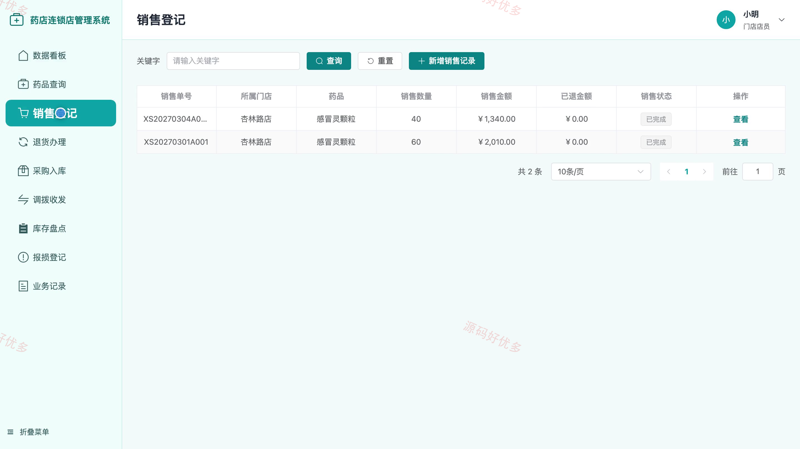
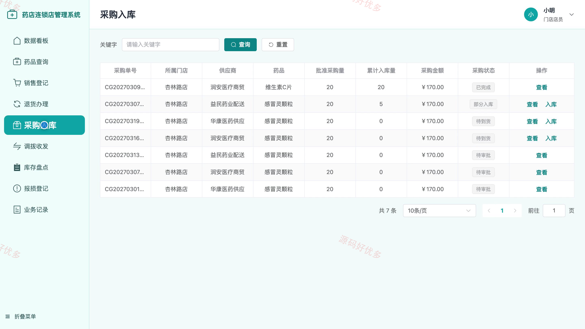
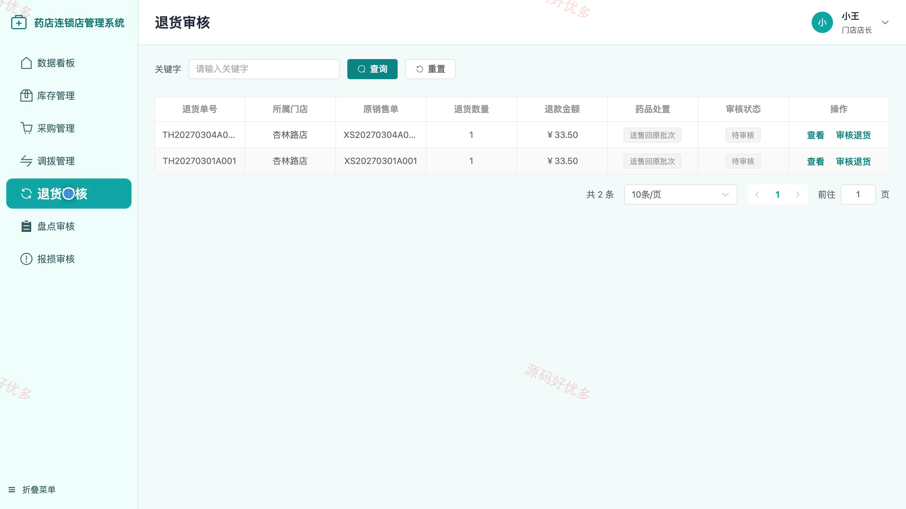
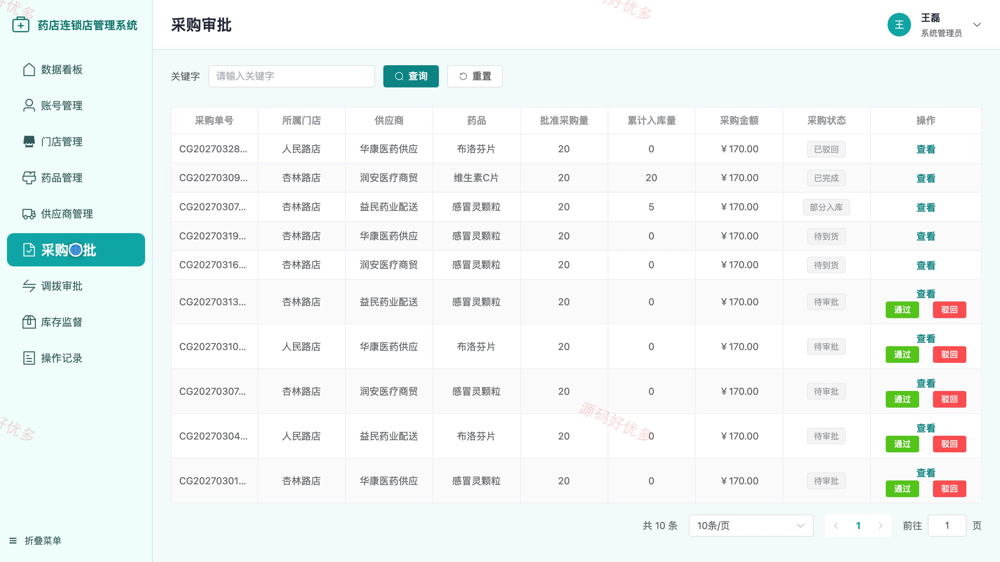
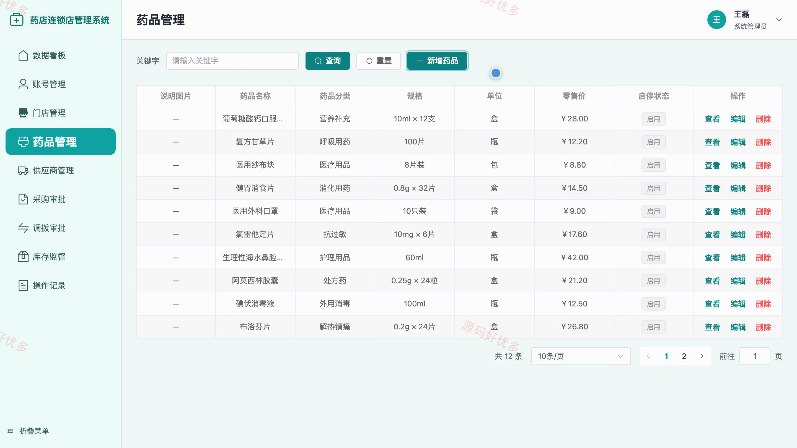

## 源码问题查看主页咨询

### 一、关键词
连锁药店管理、药品批次库存、门店销售、药品采购、跨店调拨

### 二、作品包含
源码+数据库+万字设计文档+PPT+全套环境和工具资源+本地部署教程

### 三、项目技术
前端技术： Html、Css、Js、Vue3.4、Element-Plus
后端技术：Java、SpringBoot3.2.0、MyBatis-Plus

### 四、运行环境要求
开发工具：IDEA/eclipse + VSCODE

数据库：MySQL5.7+（共15张表）

数据库管理工具：Navicat10以上版本

环境配置软件： JDK17 + Maven3.6

前端Nodejs：16+

浏览器：谷歌浏览器

### 五、项目介绍
项目编号：bs151A

药店连锁店管理系统面向门店店员、门店店长和系统管理员，支持药品销售与退货、采购入库、批次库存盘点、跨店调拨及总部审批，让门店业务和连锁管理协同进行。

角色：门店店员、门店店长、管理员

门店店员功能：查询本店药品和批次库存、登记药品销售并办理退货、按采购单办理入库、处理调拨出库与签收入库、提交库存盘点和药品报损、查看本人业务记录。

门店店长功能：查看本店经营看板与销售统计、管理批次库存和预警、提交采购与调拨申请、审核门店退货、审核盘点差异与报损。

管理员功能：管理门店账号和营业状态、维护药品与供应商资料、审批采购与跨店调拨、监督各店批次库存、查看连锁经营统计和操作记录。

### 六、运行截图

